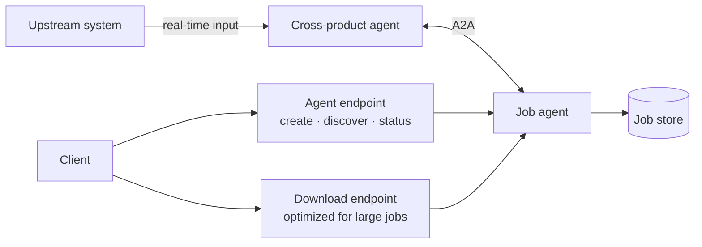
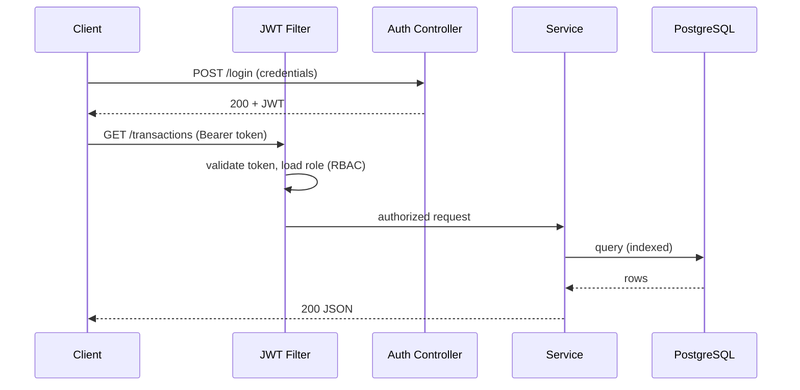
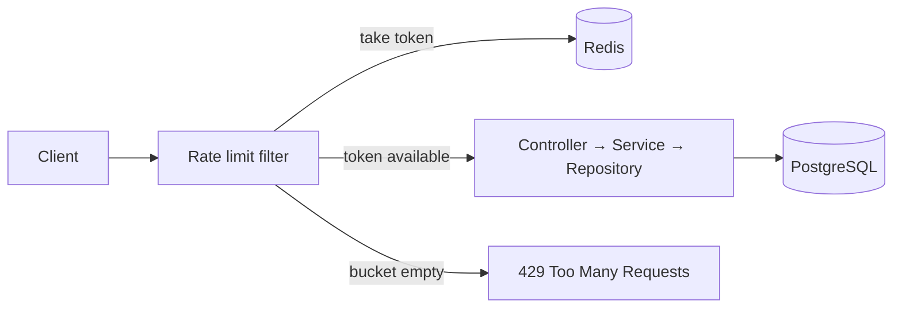

<div align="center">

<a href="https://kaustub593s.github.io">
  
</a>

<sub>↑ a recording. The real one takes your keystrokes → <a href="https://kaustub593s.github.io"><b>kaustub593s.github.io</b></a> (try <code>/help</code>, then <code>revelio</code>)</sub>

<br><br>

[](https://linkedin.com/in/kaustub-gairola-245865333/)
[](mailto:mailtokaustubgairola@gmail.com)
[](https://kaustub593s.github.io)

</div>

---

## `GET /kaustub` → `200 OK`

```json
{
  "name": "Kaustub Gairola",
  "role": "Backend Engineer",
  "education": "B.Tech CSE, KIIT University (CGPA 9.18)",
  "stack": ["Java", "Spring Boot", "Spring Security", "PostgreSQL"],
  "agents": ["Google ADK", "A2A communication"],
  "focus": ["Distributed systems", "REST API design", "Agentic AI"]
}
```

## `GET /actuator/health`

| Service | Status | What it is |
|---|---|---|
| [Vaultify](https://github.com/Kaustub593S/Vaultify) | 🟢 UP | Secure finance backend: JWT, RBAC, layered architecture, PostgreSQL |
| [URL Shortener](https://github.com/Kaustub593S/UrlShortener) | 🟢 UP | Collision-free short codes, indexed lookups, redirects |
| [Task Manager](https://github.com/Kaustub593S/TaskManager) | 🟢 UP | Secured REST API, enum status transitions, global exception handling |
| Prompt-to-App AI Platform | 🟡 BUILDING | Natural language → web app architecture and code, agentic workflow |
| API Rate Limiter | 🟡 BUILDING | Token bucket + Redis, request-interception middleware |

---

## Architecture

**Onix: enterprise AI agent** (Java, Spring Boot, Google ADK). Described at the architecture level only.



**Vaultify: JWT auth flow**



**Rate limiter: design in progress**



---

## Stack, by layer

| Layer | Tools |
|---|---|
| Language | Java, C, Python, SQL |
| Framework | Spring Boot, Spring Security, Spring Data JPA / Hibernate |
| API | REST design, JWT + RBAC, Postman, centralized validation and error handling |
| Data | PostgreSQL, indexed queries |
| Agents | Google Agent Development Kit, A2A communication, OpenAI API |
| Cloud and tooling | Google Cloud, Docker, Git, Maven, IntelliJ, Jira |

<p>

</p>

---

## `git log --oneline`

```
2026-05..06  Onix · Intern
             built an enterprise AI agent end to end (Java, Spring Boot)
             A2A communication between cross-product agents
             dual-endpoint REST design: agent operations + optimized downloads
2026-06      Prompt-to-App AI Platform started
2026-04      Vaultify shipped
2026-03      URL Shortener shipped
2026-01      Task Manager shipped
```

## Open source

**OWASP WebGoat**: merged [PR #2302](https://github.com/WebGoat/WebGoat/pull/2302), a null-safe comparison fix in the SQL Injection lesson of one of OWASP's flagship Spring Boot training projects.

## Achievements

- Shortlisted for Round 1 of **Google The Big Code** (top 15,000 across India)
- **Algo University** Stage 2 qualifier, top 8% in India (2025)
- **KIIT** Merit-Based Scholarship
- HackerRank Java certification

---

## `POST /contact`

```http
POST /contact HTTP/1.1
Content-Type: application/json

{
  "email": "mailtokaustubgairola@gmail.com",
  "linkedin": "linkedin.com/in/kaustub-gairola-245865333",
  "terminal": "kaustub593s.github.io"
}
```
