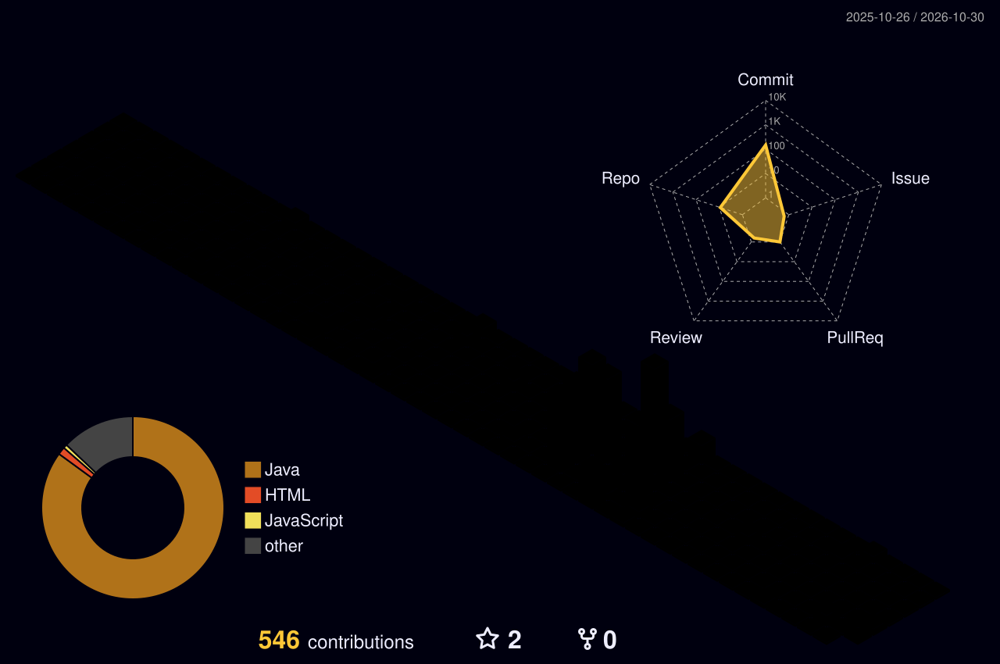

<div align="center">

<a href="https://kaustub593s.github.io">
  
</a>

<sub>↑ a recording. The real one takes your keystrokes → <a href="https://kaustub593s.github.io"><b>kaustub593s.github.io</b></a> (try <code>/help</code>, then <code>revelio</code>)</sub>

<br><br>

[](https://www.linkedin.com/in/kaustub-gairola/)
[](mailto:mailtokaustubgairola@gmail.com)
[](https://leetcode.com/u/Kaus_theta/)
[](https://kaustub593s.github.io)

</div>

---

## `GET /kaustub` → `200 OK`

```json
{
  "name": "Kaustub Gairola",
  "role": "Backend Engineer",
  "education": "B.Tech CSE, KIIT University (CGPA 9.18)",
  "stack": ["Java", "Spring Boot", "Spring Security", "PostgreSQL", "Redis"],
  "focus": ["Distributed systems", "REST API design", "Agentic AI"]
}
```

## Life of a request

<div align="center">
  
</div>

This is the layered shape my Spring Boot projects follow. It's a loop here, but in the [live terminal](https://kaustub593s.github.io) you can send the requests yourself: type `curl localhost:8080/api/projects`, then `curl localhost:8080/api/admin`, then `login admin` and try again.

---

## `GET /actuator/health`

| Service | Status | What it is |
|---|---|---|
| [Vaultify](https://github.com/Kaustub593S/Vaultify) | 🟢 UP | Secure finance backend: JWT, RBAC, layered architecture, PostgreSQL |
| [URL Shortener](https://github.com/Kaustub593S/UrlShortener) | 🟢 UP | Collision-free short codes, indexed lookups, redirects |
| [Task Manager](https://github.com/Kaustub593S/TaskManager) | 🟢 UP | Secured REST API, enum status transitions, global exception handling |
| [API Rate Limiter](https://github.com/Kaustub593S?tab=repositories) | 🟢 UP | Token bucket, Redis-backed state, request-interception middleware |
| [Prompt-to-App AI Platform](https://github.com/Kaustub593S?tab=repositories) | 🟢 UP | Natural language → working web app, repo built with Lovable |

---

## Stack, by layer

| Layer | Tools |
|---|---|
| Language | Java, C, Python, SQL |
| Framework | Spring Boot, Spring Security, Spring Data JPA / Hibernate |
| API | REST design, JWT + RBAC, Postman, centralized validation and error handling |
| Data | PostgreSQL, Redis, indexed queries |
| Agents | Google Agent Development Kit, A2A communication, OpenAI API |
| Cloud and tooling | Google Cloud, Docker, Git, Maven, IntelliJ, Jira |

<p>

</p>

---

## My contributions, as a city

<div align="center">
  
</div>

## DSA

<div align="center">
  <a href="https://leetcode.com/u/Kaus_theta/">
    
  </a>
</div>

---

## Open source

**OWASP WebGoat**: merged [PR #2302](https://github.com/WebGoat/WebGoat/pull/2302), a null-safe comparison fix in the SQL Injection lesson of one of OWASP's flagship Spring Boot training projects.

## Achievements

- Shortlisted for Round 1 of **Google The Big Code** (top 15,000 across India)
- **Algo University** Stage 2 qualifier, top 8% in India (2025)
- **KIIT** Merit-Based Scholarship
- HackerRank Java certification

---

## `POST /contact`

| | |
|---|---|
| ✉️ Email | [mailtokaustubgairola@gmail.com](mailto:mailtokaustubgairola@gmail.com) |
| 💼 LinkedIn | [linkedin.com/in/kaustub-gairola](https://www.linkedin.com/in/kaustub-gairola/) |
| 🧩 LeetCode | [leetcode.com/u/Kaus_theta](https://leetcode.com/u/Kaus_theta/) |
| 💻 Terminal | [kaustub593s.github.io](https://kaustub593s.github.io) |
| 🐙 GitHub | [github.com/Kaustub593S](https://github.com/Kaustub593S) |
